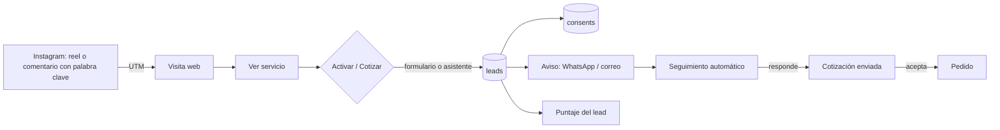
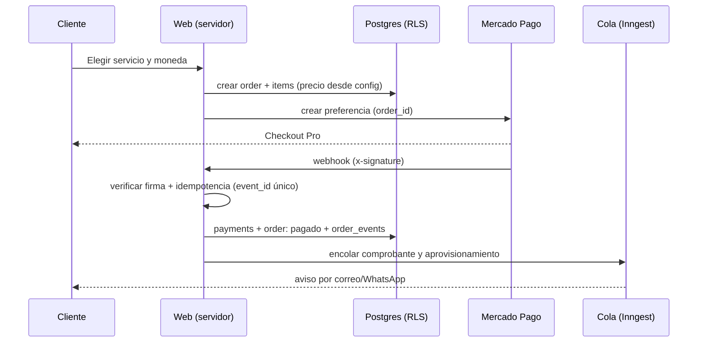
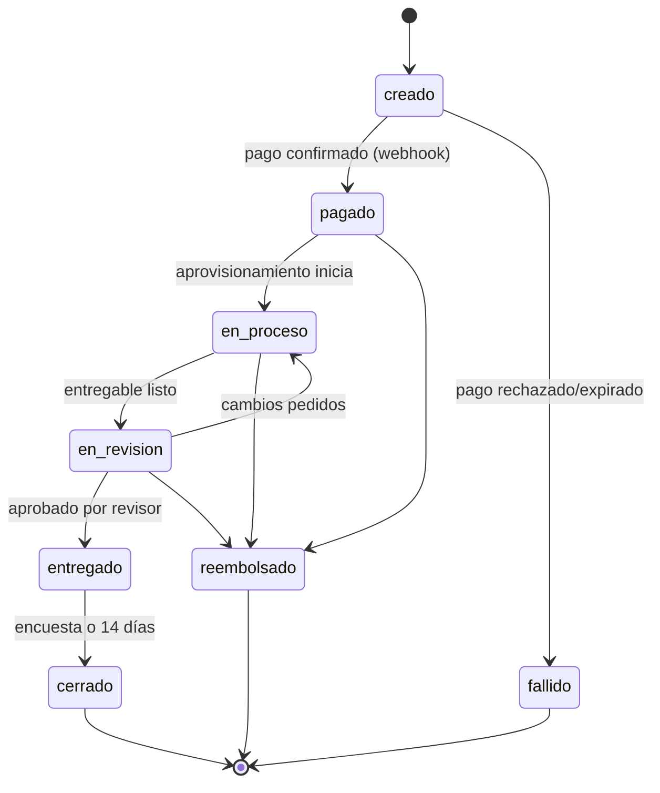
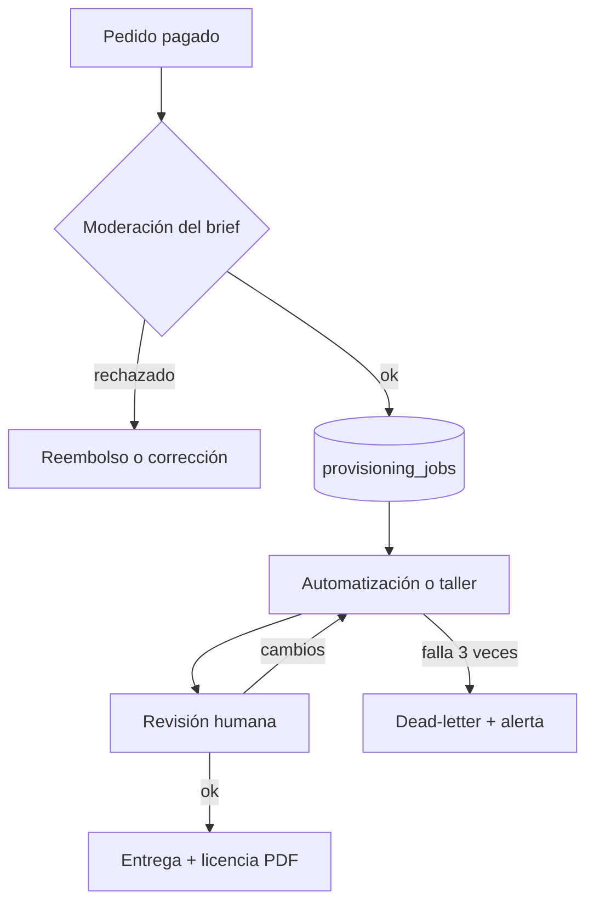
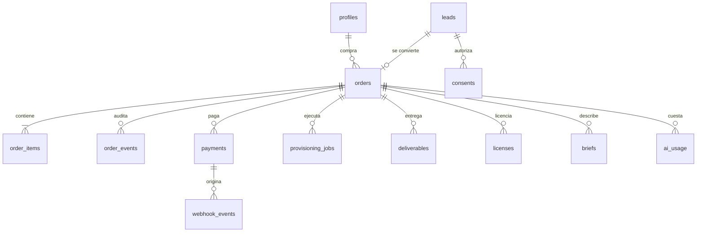

# THREE3 — Flujos de información y modelo de datos (v1)

Fuente única de verdad de precios: `packages/config/services.config.json`. **El servidor calcula todo importe; el cliente nunca envía precios.**

## 1. Captación (Instagram → lead)

Reglas: sin consentimiento expreso no se guarda el lead; la fuente (`utm_*`) se guarda; ningún evento de analítica lleva PII.

## 2. Compra y pago

Controles: firma obligatoria; `webhook_events(provider, event_id)` único (repetir un webhook no cambia nada); reconciliación periódica contra la API de Mercado Pago; si el webhook no llega, el pedido sigue "creado" hasta reconciliar.

## 3. Estados del pedido

Solo el servidor mueve estados, con una función `transition(order, to, actor)` que valida la tabla de transiciones y escribe en `order_events` (quién, cuándo, de→a, motivo). El cliente no puede saltarse ningún estado.

## 4. Aprovisionamiento por servicio
| Servicio | Automático | Humano | Entrega |
|---|---|---|---|
| Sheets | Copia de plantilla vía API (OAuth, permisos mínimos) | — | Enlace a la hoja |
| CRM | Plantilla versionada + checklist | Revisión de configuración | Acceso + guía |
| Leads | Workflow n8n parametrizado + prueba de humo | Revisión de la prueba | Flujo activo + reporte |
| Chatbot | Plantilla + base de conocimiento del cliente | Verificación de Meta (pendiente) | Estado `pendiente_verificacion` hasta aprobar |
| Personaje 3D | Moderación del brief | Boceto B/N → aprobación → modelado/render | PNG, turntable, GLB, licencia PDF |
| Videojuego | Moderación + generación en sandbox | Revisión humana obligatoria | Enlace + ZIP + licencia |

Sandbox de juego: sin secretos, red solo a lista blanca, límites de CPU, tiempo y costo; corre en el worker, nunca en la función web.

## 5. Analítica de embudo (sin PII)
Eventos: `visit` → `service_view` → `activate_click` → `lead_created` → `checkout_start` → `paid` → `delivered`. Atributos permitidos: `utm_*`, `service_id`, `device`, `order_value_bucket`. Prohibido: correo, nombre, celular, IP completa. Solo se mide con consentimiento de cookies analíticas.

## 6. Asistente de ventas (IA propia, fase posterior)
Servidor → Claude API con: prompt versionado, catálogo como única fuente, tope de gasto por conversación y por día, salida validada con Zod, registro de costo en `ai_usage`, identificación obligatoria "asistente virtual", derivación a una persona, y rechazo de instrucciones dentro de mensajes del usuario (defensa contra inyección de prompts). Si la IA falla, el lead se guarda igual y se avisa.

## 7. Modelo de datos

| Tabla | Campos clave | RLS (resumen) |
|---|---|---|
| `profiles` | id (= auth.uid), nombre, rol | El usuario lee/edita solo su fila |
| `leads` | id, servicio, contacto, fuente (`utm_*`), puntaje, estado | Insert por servidor; lectura solo staff |
| `consents` | lead_id/user_id, finalidad, texto_versión, fecha, ip_hash | Solo servidor y staff; inmutable |
| `orders` | id, user_id, moneda, total_calculado, estado, version | Cliente lee solo los suyos; escritura solo servidor |
| `order_items` | order_id, service_id, precio_unitario_snapshot | Como `orders` |
| `order_events` | order_id, de, a, actor, motivo, fecha | Solo inserción; lectura del dueño y staff |
| `payments` | order_id, proveedor, provider_payment_id (único), monto, estado | Solo servidor |
| `webhook_events` | proveedor, event_id (único con proveedor), payload, firma_ok | Solo servidor |
| `provisioning_jobs` | order_id, tipo, estado, intentos, error | Solo servidor y staff |
| `briefs` | order_id, tipo, contenido, estado_moderación, declaración_de_autoría | Dueño lee; moderación staff |
| `deliverables` | order_id, ruta en Storage, tipo, checksum | URLs firmadas y temporales para el dueño |
| `licenses` | order_id, tipo, alcance, id_público, pdf | Dueño lee y descarga |
| `ai_usage` | order_id/lead_id, modelo, tokens, costo | Solo servidor y staff |
| `data_requests` | usuario, tipo ARCO, estado, plazo | Dueño y staff |
| `takedown_cases` | denunciante, material, estado | Solo staff |
| `admin_audit` | admin, acción, objeto, fecha | Solo inserción; solo admins |

Principios: todas las tablas con RLS activa y denegación por defecto; migraciones versionadas; `service_role` solo en servidor; backups diarios con prueba de restauración; PII cifrada en reposo y fuera de los logs.
