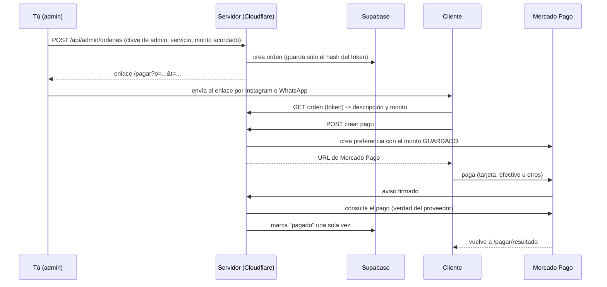

# Pagos y seguridad: cómo funciona y qué falta activar

## Flujo (el cliente nunca elige el precio)


## Controles de seguridad (todos con prueba automática salvo lo marcado)
| Riesgo | Control | Prueba |
|---|---|---|
| Alterar el precio | El monto se guarda al crear la orden; el cliente solo envía `orden` y `token` | `server/pagos/pagos.test.ts` |
| Adivinar enlaces de otros | Token aleatorio de 256 bits; solo se guarda su hash; respuesta idéntica si falta la orden o el token | ✔ |
| Avisos falsos | Firma HMAC-SHA256 de Mercado Pago, ventana de 10 minutos y comparación en tiempo constante | ✔ |
| Avisos repetidos | Clave única por `proveedor + pago + estado`; repetir no cambia nada | ✔ (también a nivel de base de datos) |
| Pago de otro monto o moneda | Se compara con la orden y queda como anomalía, sin marcar pagado | ✔ |
| Doble pago | Segundo pago aprobado genera anomalía para devolver | ✔ |
| Saltarse estados | Máquina de estados; el cambio exige el estado anterior (control optimista) | ✔ |
| Robo de la clave de Mercado Pago | Solo en variables secretas del servidor, nunca en el código ni en el navegador | revisión + gitleaks en CI |
| Datos de tarjeta | Nunca pasan por nuestros servidores (pago en la página de Mercado Pago) | por diseño |
| Spam y bots en el formulario | Turnstile (verificado en el servidor, falla cerrado), campo trampa, límite por IP, tamaño máximo | ✔ |
| Lectura de la base de datos | RLS activo y sin políticas: solo el servidor con la clave de servicio entra | ✔ (`server/db.test.ts`) |
| Duplicados de leads | Índices únicos + función atómica; 60 envíos simultáneos dan 1 contacto | ✔ |
| Inyección de scripts (XSS) | CSP estricta con hash por página, sin `unsafe-inline` en scripts; páginas de pago usan `textContent` | ✔ en navegador real (`scripts/probar-csp.mjs`) |
| Ser embebidos en otro sitio | `frame-ancestors 'none'` | ✔ |
| Filtrar el token por Referer | `Referrer-Policy: no-referrer` en `/pagar*` | revisión |

**Lo que no está probado:** la conexión real con Mercado Pago, Supabase y Turnstile (necesitan tus cuentas). Las pruebas usan respuestas simuladas con el formato oficial. Antes de cobrar de verdad se prueba en el modo de pruebas de Mercado Pago (tarjetas de prueba) y se hace un pago real de S/ 1 con reembolso.

## Lo que debes crear y configurar (en este orden)
1. **Cloudflare Pages** conectado a este repo: carpeta raíz `THREE3-web`, comando `npm run build:cf`, salida `out`. Las funciones de `functions/` se detectan solas.
2. **Supabase:** crear proyecto y ejecutar `supabase/migrations/0001_base.sql` en el editor SQL.
3. **Mercado Pago:** cuenta de vendedor, credenciales de **prueba** primero. Configurar en Webhooks la URL `https://TU-DOMINIO/api/pagos/webhook` y copiar la clave secreta.
4. **Cloudflare Turnstile:** crear un sitio y copiar la clave pública y la secreta.
5. **Variables en Cloudflare Pages** (Settings → Variables and secrets):

| Variable | Tipo | Valor |
|---|---|---|
| `SITE_URL` | texto | `https://TU-DOMINIO` |
| `ENTORNO` | texto | `produccion` |
| `SUPABASE_URL` | texto | URL del proyecto |
| `SUPABASE_SERVICE_KEY` | **secreto** | clave `service_role` (nunca la pública) |
| `MP_ACCESS_TOKEN` | **secreto** | Access Token de Mercado Pago |
| `MP_WEBHOOK_SECRET` | **secreto** | clave secreta del webhook |
| `MP_SANDBOX` | texto | `1` mientras pruebas |
| `ADMIN_TOKEN` | **secreto** | una clave larga aleatoria (solo tú la conoces) |
| `TURNSTILE_SECRET` | **secreto** | clave secreta de Turnstile |
| `NEXT_PUBLIC_TURNSTILE_SITEKEY` | texto (se compila) | clave pública de Turnstile |
| `NEXT_PUBLIC_LEADS_ENDPOINT` | texto (se compila) | `/api/leads` |
| `NEXT_PUBLIC_NOINDEX` | texto | `0` solo al lanzar |

6. **Regla de límite en Cloudflare (WAF → Rate limiting):** `/api/*` máximo 30 solicitudes por minuto por IP. Es el límite duro; el del código es adicional **[VALIDAR el plan gratis]**.
7. **Opcional:** un espacio KV llamado `LIMITES` enlazado a las funciones, para que el límite del código sea compartido entre servidores.

## Cómo cobrar a un cliente (cuando todo esté listo)
```
curl -X POST https://TU-DOMINIO/api/admin/ordenes \
  -H "Authorization: Bearer TU_ADMIN_TOKEN" -H "Content-Type: application/json" \
  -d '{"servicio_id":"crm","monto_pen":2500,"descripcion":"CRM para Café Luna"}'
```
La respuesta trae el `enlace` para enviar al cliente. Nadie más puede crear órdenes.

## Efectivo, Yape y otros
Se activan desde tu cuenta de Mercado Pago (medios de pago aceptados); el código no cambia. Niubiz o PagoEfectivo directo solo si más adelante la comisión o la aprobación lo justifican.
